# 附录 · activetheory.net/work 卡片专项拆解

范围：卡片文字、荧光感、悬停、排列的空间感。
**结论（能直接抄的数字和参数）→ [checklist.md](checklist.md)**

抓取日期：2026-09-26 · 线上版本 `app.1780406240914.js` · 数据 `projects-dev.json`（65 个项目，取 14 个）

---

## 方法

1. **读线上源码。** 页面是 Hydra 框架打包的一个文件 `assets/js/app.*.js`，所有着色器在 `assets/shaders/compiled.vs`（按 `{@}name{@}` 分段，共 174 个），场景参数在 `assets/data/uil.*.json`。卡片相关的类有 `WorkItems`（排列、滚动→相机）、`WorkItem`（悬停、uniform）、`WorkPaneUI`（文字画布）；着色器是 `WorkItemShader.glsl`（玻璃）和 `WorkItemUIShader.glsl`（文字）；后期在 `ViewController` + `GlobalComposite.fs`。用到的 UIL 参数摘录在 [`data/uil_work_subset.json`](data/uil_work_subset.json)。
2. **在 Chrome 里实际跑。** 用 Playwright 驱动 Chromium（SwiftShader 软件 WebGL）。站点的 GPU 黑名单里有 `swiftshader`，会跳到 `/unsupported`，所以 init 脚本把 `UNMASKED_RENDERER` 改报成 RTX 3070，让它按桌面最高档渲染（[`tools/common.js`](tools/common.js)）。
3. **注入脚本抓帧。** 通过 `AppState.get("Work/scene" | "Work/camera" | "ViewController/scroll")` 拿到场景对象（[`tools/helpers.js`](tools/helpers.js)），然后：
   - 反解 `smoothStep(0.06, 0.94, p) = k/13`，把滚动精确停到第 k 张卡，或者两卡之间的 f = 0.25/0.5/0.75/1；
   - 用 `Render.createTimeMultiplier().value = 1e-4` **冻结时间**（设成 0 整个 3D 层会停止渲染），保证开/关对照是同一帧；
   - 开关项：隐藏文字 mesh；把合成 pass 的 `tUnrealBloom` / `tLightStreak` 换成黑图；用 `Object.defineProperty` 把 `tRefraction`、`tMap`、`uHover` 钉死在指定值；
   - 每一帧导出相机、每张卡的世界坐标、距离、朝向夹角、投影到屏幕的四角、renderOrder、混合状态。
4. **像素分析。** [`tools/analyze.py`](tools/analyze.py) 按投影四角做多边形 mask，算亮度和颜色；`base − noUI` 得到文字加法层，`base − noBloom` 得到 bloom 贡献，对 R/G/B 做互相关求错位像素。
5. 测了两个停靠位置（第 6 张 "20 Years of Xbox"、第 2 张 "Chile 20"；项目顺序每次加载都会打乱，所以悬停那一组是重新加载后的另一张卡），外加一次真实鼠标悬停的采样（[`tools/hover.js`](tools/hover.js)）。

复现：`tools/run_all.sh`（需要 Playwright 1.56 和 `/opt/pw-browsers/chromium`；代理 CA 要装进 `~/.pki/nssdb`）。

### 注意事项（看数字之前先读）
- **视频没播。** 这个 Chromium 没有 H.264，所以 `uVideoBlend` 一直是 0，卡上显示的是缩略图（×0.7）。线上正对卡会在 300 ms 后用 500 ms 淡入视频，视频项是 `min(video, 0.5) × 0.45` 再加 soft-light，所以真实的正对卡会比这里的截图稍亮、颜色更饱和。
- 软件渲染每帧 0.7–3 s。所有时间类数字（悬停、缓动）都来自源码公式，真实鼠标那次只用来验证曲线形状（每帧 Δt 被封顶在 200 ms）。
- 冻结时间后，花形粒子的显隐还会被别的状态驱动，所以 bloom 差分图里粒子区域有污染；bloom 的百分比只在卡片和文字的 mask 里统计。
- 亮度都是 sRGB 0–255 的 Rec.601 luma，1280×720，DPR 1。

---

## A. 卡片文字

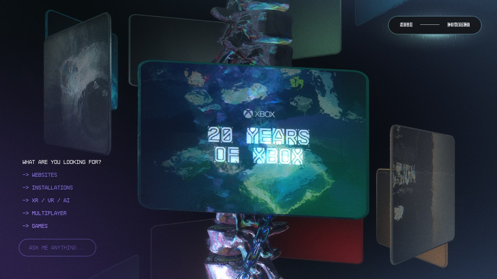

| 文字放大 3× | 文字加法层（base − noUI）|
|---|---|
| 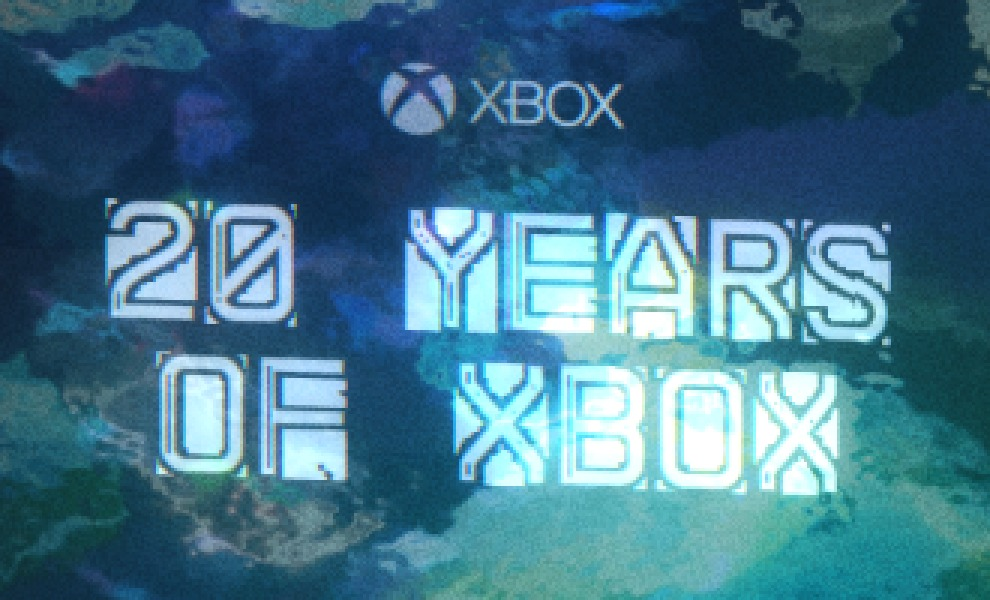 | 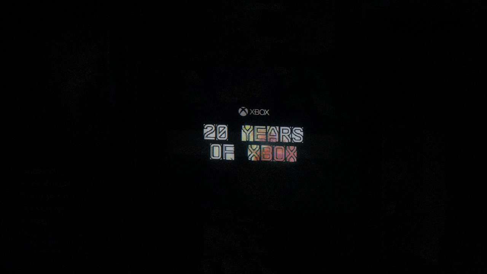 |

**贴图是怎么来的。** 每张卡有一张 1024² 的离屏 GL-UI 画布（`WorkPaneUI` → `UI3D`），里面画 logo（或客户名）+ 标题；正文 copy 的 alpha 是 0。这张画布贴在一块**独立于玻璃的** 4×2 平面上，平面往前拱起 0.1～0.4（离玻璃有真实距离，所以转动时有视差），用**加法混合**叠上去。

**亮度和颜色。** 加法层本身平均只加约 100/255 的中性白（p95 ≈ 170），但因为叠在有颜色的玻璃上，最终文字像素 luma 中位 198，最亮的 10% 被裁成白。文字的"颜色"其实是**白 + 字底下玻璃的颜色**：青色卡上的字发青（147, 199, 216），红色卡上的字发粉（209, 170, 181）。着色器会往卡片的 `uColor` 方向偏 5% 的色相，肉眼几乎看不出来。

**字形。** NB Architekt 是带内线的镂空几何体，所以字看起来是"双线"的；内线描边大约 3 px。字距 0.01 em，实测字间空隙约 2 px。纹素竖向拉长 1.19 倍，所以字比字体本身更瘦长。

**RGB 错位。** 正对卡上错位量是 0.001 UV，不到半个像素（实测 0 px）；你看到的彩边主要来自离轴卡。滚到两卡中间（41° 离轴）时，实测 R/B 各 ±2 px。同一个 `edges` 参数还会把画布切成 15 条竖切片——这就是"扫描线/故障"的观感。真正的横向扫描线代码（`fract(lineUV.y*7)`）在当前版本里被注释掉了。

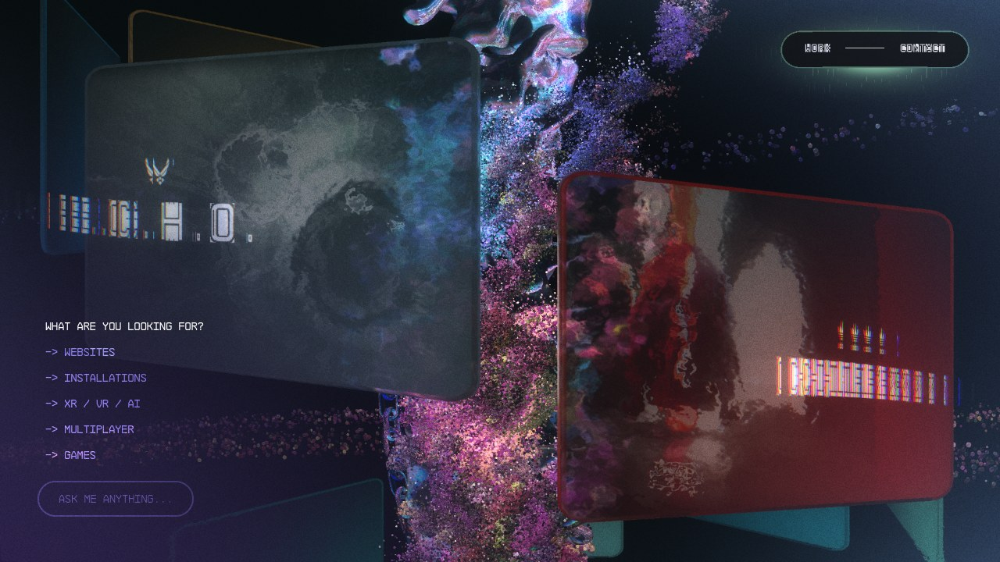

**版式（相对卡片）。** 见 checklist A1。要点：logo 在中心上方 17.5% 卡高处；标题块在中心下方约 4% 处；整块文字只占卡宽的 45% 左右，四周留很多空。

### 荧光感来源

| bloom 开（base）| bloom + 光条 关 |
|---|---|
|  | 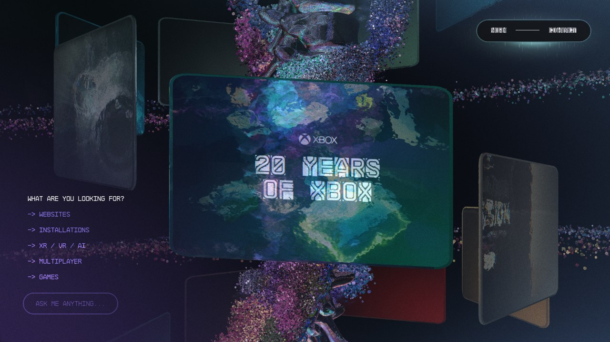 |

bloom 差分 ×4：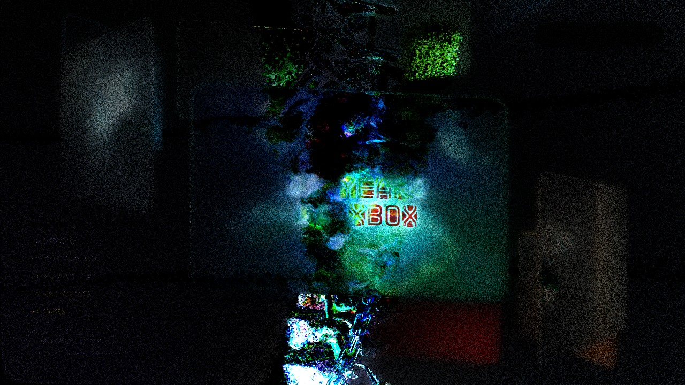

| 测量项 | 卡 6 | 卡 2 |
|---|---|---|
| bloom 占文字亮度 | 17.1% | 13.9% |
| bloom 占卡片亮度 | 7.1% | 7.6% |
| bloom 占整帧亮度 | 2.5% | 1.0% |
| 镜头光条 | ≈0 | ≈0 |
| 文字加法层占卡片亮度（base vs noUI）| 15% | 5% |
| 折射占卡片亮度（noRefraction）| 6% | 5.5% |
| 缩略图占卡片亮度 | 37% | 43% |

结论：荧光感 = **加法白字（被裁白）+ 有色玻璃托底 + 一层低强度、大半径、无阈值的整帧 bloom（pow 1.8，文字这种高光吃得最多）**。字**没有**写进 emissive 或体积光 MRT —— 卡片的 MRT 只有 `Color` 和 `WorkRefraction`（后者给玻璃折射用），文字着色器只输出 `Color`。

---

## B. 悬停

强制把 uHover 设成 0 / 0.5 / 1（同一冻结帧）：

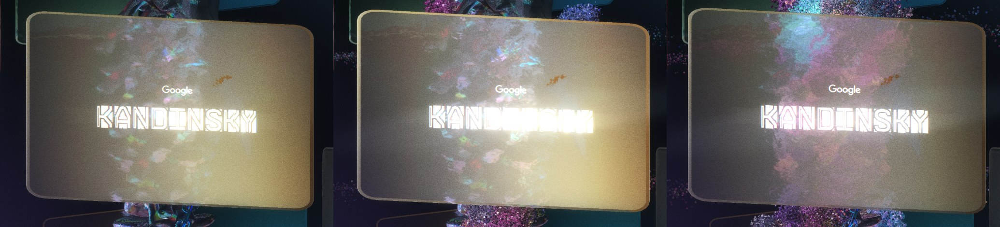
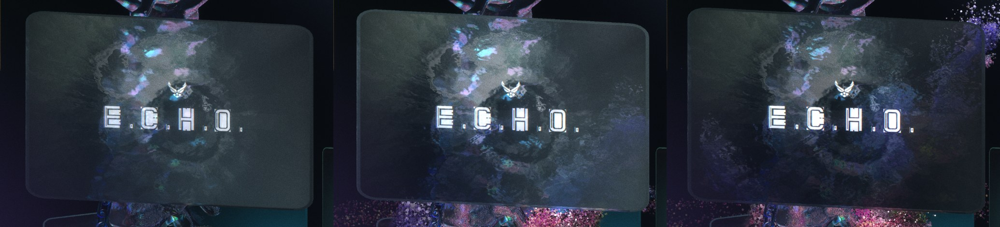

- 0 → 0.5：整张卡**闪亮**（`+0.3 × smoothstep(0.5, 0, |uHover−0.5|)`），色光斑从卡中心往鼠标位置移。
- 0.5 → 1：闪光退掉；折射偏移放大到 2.5 倍、折射亮度 ×0.7 → 玻璃里的东西更碎更糊，卡面**比悬停前暗 7–12%**；文字增益 0.65 → 0.9，所以字更亮。卡往前推 0.2（约放大 3.6%）。没有缩放、倾斜或旋转。
- 离开时走同一个 lerp，所以也会在中途闪一次。

真实鼠标采样（[`data/hover_real_mouse_samples.json`](data/hover_real_mouse_samples.json)）：移入 0 → .632 → .865 → .950 → .982；移出 1 → .368 → .135 → .050。每帧 α = 1 − 0.92¹² = 0.632（Δt 封顶 200 ms = 12 个 60 Hz 帧），和源码里帧率归一化的 `lerp(…, 0.08)` 完全一致 → 真实 60 fps 下 τ = 0.20 s，90% 在 0.46 s。

| 移入后 | 移出后 |
|---|---|
| 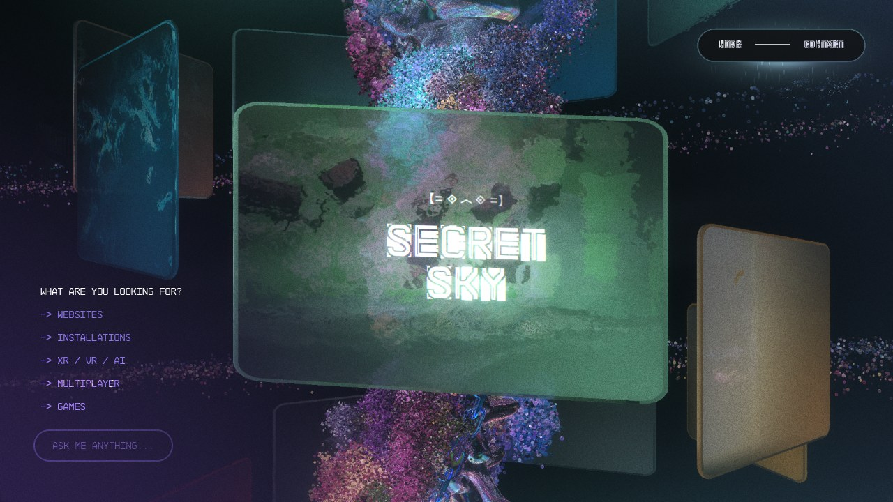 | 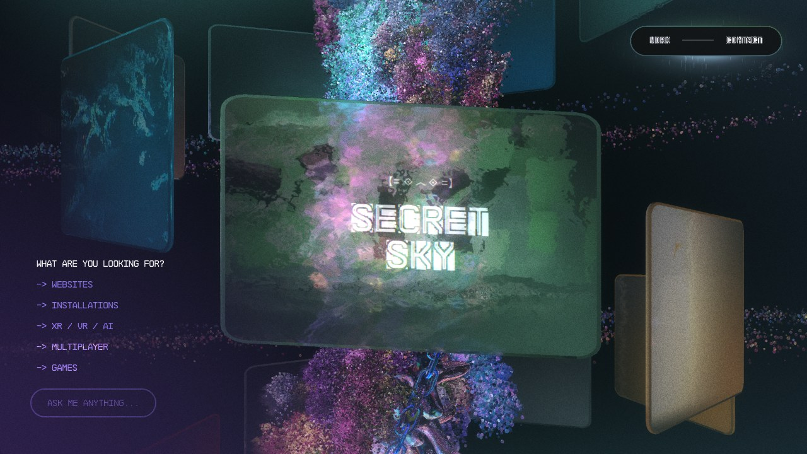 |

**鼠标流体。** 流体模拟只作为花形粒子的一个行为（"Mouse Fluid" preset）；`GlobalComposite` 里所有流体扭曲都乘了 `uContact`（只在 Contact 页不为 0）。卡片本身只响应平滑后的 `uMouse`（顶点 x 偏 0.03，折射 uv 偏 0.02，悬停时色光斑跟着鼠标走）。**卡片上没有单独加强的流体扭曲。**

---

## C. 排列的空间感

停在第 6 张卡 → f = 0.25 → 0.5 → 0.75 → 1（下一张）：

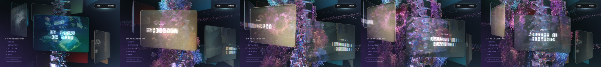
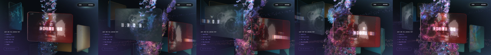

**结构。** 14 张卡沿螺旋排：半径 3.8，每张转 −50°，下降 0.84，法线朝外。脊椎、锁链、花形粒子在中轴上。相机永远在"当前卡外侧 2 倍半径 + 2"的位置往里看，所以一次只正对一张，左右邻卡以 72° 侧身出现（上下错开是因为 y 在下降），脊椎后面能看到另一侧卡片的背面。

**停下时一屏的内容（卡 6，数字在 checklist C1）**：1 张正对（占屏幕 25%），2 张侧面竖条（各约 6%，几乎没字，只剩缩略图和玻璃），远处 6～8 张背面碎片。所有玻璃都是 alpha 1——远卡看起来"透"，是因为正对卡的玻璃在采样折射快照。

**深度。** 正对 5.79 → 邻卡 7.76（+34%）→ ±2 张 11.0 → 脊椎后 12.2–13.6。相邻卡在屏幕上不重叠（横向留 5.5% 屏宽）；远卡被正对卡和脊椎挡住。

**穿插顺序。** 先画不透明的脊椎/锁链/粒子（写深度），再画卡片，每帧按离相机距离从远到近排序（玻璃 = i，文字 = i+1）。所以前后关系就是真实深度：正对卡盖住脊椎，脊椎盖住远卡，粒子团绕着中轴，会从卡边前面飘过（f = 0.5 那帧最明显）。

**滚动时。** 相机在两个目标点之间走直线（弦），所以滚到一半时相机离中轴更近（7.6 → 6.89），两张卡都以 41° 侧身、各占 39.5% 屏宽，中间露出 8.6% 屏宽的脊椎和粒子。f 在 0.2–0.8 之间两张卡同时有字。**没有吸附**：停在哪就是哪；"当前卡"（播视频的那张）在 f = 0.5 切换。

---

## 文件

```
appendix-work-cards/
├── README.md            本文
├── checklist.md         照做清单（数字 + 参数）
├── frames/              截图（1280×720，JPG）：base / noUI / noBloom / noRefraction / hover / 滚动 / 差分图
├── data/
│   ├── metrics_c6.json, metrics_c2.json      每个状态：相机、每张卡的世界坐标/距离/夹角/屏幕四角/renderOrder
│   ├── analysis_c6.json, analysis_c2.json    像素分析结果
│   ├── hover_real_mouse_samples.json         真实鼠标 uHover 时间序列
│   ├── scroll_views.json                     FXScroll 各段 start/height
│   └── uil_work_subset.json                  线上 UIL 参数里和 Work/bloom/流体有关的部分
└── tools/               common.js（启动 + GPU 改报）、helpers.js（页面内注入）、capture.js、hover.js、analyze.py、run_all.sh
```
